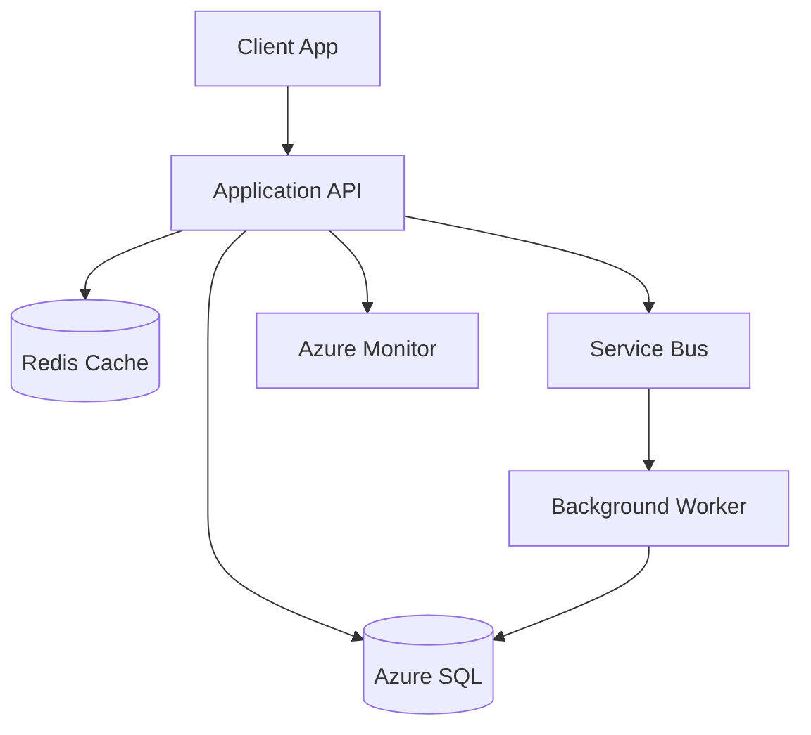

# 06. Phase 2: Database Architecture and Technology Selection

## 1. Concept

Simple Hinglish:

Database selection ek bahut important decision hai. Agar sahi database choose kiya toh system smooth chalta hai. Agar galat database choose ho gaya, toh performance, cost, scalability, and consistency issues aayengi. Database ka decision business requirement, data model, workload pattern, consistency need, and operational complexity par depend karta hai.

Professional interview answer:

Database architecture is driven by data characteristics, transactional behavior, consistency requirements, latency expectations, query patterns, availability targets, security constraints, and operational complexity. The architect selects a database model based on workload needs rather than on familiarity or vendor preference alone.

## 2. Why Does a Business Need This?

Database is usually the most critical and expensive dependency in the architecture. Problems here affect:

- application performance
- transaction correctness
- backup and restore capability
- failover behavior
- compliance and auditability
- cost efficiency

## 3. Database Discovery Questions

- Is the data relational or non-relational?
- Are ACID transactions required?
- Is strong consistency required?
- What is the estimated volume and growth rate?
- What is the read/write ratio?
- Are complex joins required?
- Is there a need for global distribution or multi-region reads?
- Is low-latency access required?
- Is reporting and analytics required?
- Is the database already present on-premises?
- Is compatibility with SQL Server or MySQL important?
- What are the RPO and RTO requirements?
- Is cross-region replication required?
- Are there security and compliance needs?
- Is data geo-locality a requirement?

## 4. Data Characteristics and Design Impacts

### Relational data

- strict schema
- transactional integrity
- joins and complex queries
- strong consistency

### Non-relational data

- flexible schema
- high scale
- global distribution
- high-throughput event or document patterns

## 5. Database Technology Comparison

### Azure SQL Database

What it is:

- fully managed relational database service

Ideal use cases:

- OLTP workloads
- ERP and business applications
- SaaS multi-tenant business apps

When to use:

- transactional consistency needed
- you want managed SQL platform with patching and backups

When not to use:

- global low-latency document workloads
- very flexible schema on a large scale

Scalability:

- vertical and vertical scaling depending on service tier
- read scale and elastic pools available depending on pattern

Availability:

- built-in redundancy and availability options

Security:

- TDE, private endpoints, RBAC, managed identities

Cost:

- good for many OLTP use cases, but not always cheapest for very large scale analytics-heavy workloads

### Azure SQL Managed Instance

Use when:

- near-100% SQL Server compatibility required
- need more feature parity with SQL Server

Good for:

- database migration programs
- existing SQL Server apps with compatibility dependence

Not ideal for:

- simple cloud-native apps that do not need SQL Server compatibility

### SQL Server on Azure VM

Use when:

- custom OS and SQL configuration is required
- legacy vendor dependencies
- advanced DB tuning or third-party software integration

Trade-offs:

- more operational overhead
- customer-managed patching

### Azure Database for PostgreSQL

Use when:

- open-source PostgreSQL workload required
- strong SQL compatibility and extension support needed

### Azure Database for MySQL

Use when:

- MySQL compatibility and managed service needed

### Azure Cosmos DB

Use when:

- globally distributed app
- schema flexibility
- low-latency access
- multi-region writes and reads

Not ideal when:

- heavy relational joins and transaction patterns are fundamental

Consistency models:

- strong, bounded staleness, session, eventual

### Azure Cache for Redis

Use when:

- session data
- frequently accessed hot read data
- low-latency caching

Not ideal for:

- primary transactional system of record

### Azure Storage Tables

Use when:

- lightweight key-value or table-read no-SQL usage needed
- low-cost storage patterns

Not ideal for:

- complex relational and transactional requirements

### Data lake / analytical storage

Use when:

- large-scale analytics and BI workloads
- cold and warm data storage
- integrating operational and analytical processing

## 6. Database Decision Matrix

| Business requirement | Data characteristics | Recommended database | Alternative | Why | Trade-off |
|---|---|---|---|---|---|
| Banking transactions | strong consistency, relational | Azure SQL Database / MI | PostgreSQL | relational integrity and transactional model | cost and operational complexity |
| E-commerce orders | transactional order processing | Azure SQL Database | Cosmos DB | ACID behavior and relational modeling | less suited for global low-latency flexible JSON |
| Product catalog | mostly reads, moderate structure | Azure SQL or Cosmos DB | Redis cache | simple access pattern and read-heavy workload | eventual consistency depending on design |
| Customer profiles | global, low latency, flexible JSON | Cosmos DB | SQL DB | global and flexible shape | more complex query design |
| Session data | temporary and high-speed | Redis | Cosmos DB | low latency, simple store | not durable as primary data |
| IoT telemetry | high-volume time series | Event Hubs + storage or Cosmos DB | SQL DB | ingestion and scale | not ideal for relational transaction patterns |
| Financial reporting | analytic workloads | Synapse / SQL + lake | operational DB | separation of OLTP and OLAP | more architectural components |
| Audit logs | append-heavy and long retention | Azure Data Explorer / Log Analytics / Storage | SQL | analytics and log scale | more specialized ops |

## 7. Microservices Database Patterns

### Database-per-service

Use when:

- service autonomy is critical
- team independence needed
- different datastore technology is needed per service

Advantages:

- separate scaling and ownership
- independent technology decisions

Disadvantages:

- operational complexity
- distributed transactions become harder
- more migration and monitoring effort

### Shared database

Use when:

- smaller systems
- not enough maturity or complexity to justify separate dbs
- simpler operational model

Advantages:

- less complexity
- easier transactions and reporting

Disadvantages:

- coupling between services
- less independence
- harder scaling and ownership boundaries

### Important architect point

Not every microservice needs a physical separate database. Shared database can be valid when the business needs are modest and team maturity is low. The real decision is data ownership and coupling risk, not a doctrine-driven one-size-fits-all.

## 8. Practical Scenarios

### Banking transactions

- relational, strong consistency, auditability
- use SQL database and strong backup/restore strategy
- multi-region DR and private networking

### E-commerce orders

- transaction and inventory order flow
- use SQL for order system of record
- asynchronous service bus for downstream notifications and inventory update events

### Product catalog

- mostly read-heavy, moderate updates
- use SQL or Cosmos depending on complexity and geographic needs
- caching in Redis may help scale

### Shopping cart

- session-like, user-specific, often short-lived
- Redis is good for low-latency state
- persist final cart state to database when needed

### Customer profiles

- flexible profile attributes, global access
- Cosmos DB often suitable if globally distributed

### IoT telemetry

- extremely high ingestion volume
- use Event Hubs or Kafka, storage, and analytics backends

### Audit logs

- append-only and long retention
- use specialized log/analytics storage and policy-based retention

## 9. Architecture Diagram

## 10. Security and DR Considerations

- always use encryption at rest and in transit
- private endpoints for data services
- managed identities for app access
- backup retention and disaster recovery plans
- region failover design if RPO/RTO demands require it

## 11. Cost and Trade-offs

- SQL is strong for consistency and relational queries
- Cosmos DB is excellent for global scale and flexible data, but not always a simple replacement for SQL
- Redis is fast and cheap for caching but not durable as primary storage
- managed DBs reduce ops effort but can cost more than self-managed VMs in some cases

## 12. Common Mistakes

- using Cosmos DB for everything because it is scalable
- using SQL for all workloads without evaluating consistency and data model
- not separating OLTP and analytics workloads
- ignoring backup and restore needs
- not considering data ownership boundaries across microservices

## 13. Interview Questions

### Basic

- What factors decide the database technology for a workload?
- When would you choose SQL vs Cosmos DB?
- What is the role of Redis in an application architecture?

### Intermediate

- How do you decide between SQL Database and Managed Instance?
- When would a shared database be acceptable in a microservices environment?
- How does RPO and RTO influence database selection?

### Advanced

- How do you decide between relational database, document database, and cache in a large enterprise platform?
- What are the trade-offs of database-per-service vs shared database?
- How do you explain a database architecture to a business stakeholder who does not understand terms like ACID or consistency?

## 14. Quick Revision

- Database choice depends on workload, not preference.
- OLTP and analytical workloads should usually be separated.
- Consistency, latency, scale, and operational complexity dominate the decision.
- A strong DB design supports the architecture; a weak DB design creates system-level failure.

## 15. Knowledge Checkpoint

- What is the key difference between SQL and Cosmos DB?
- When is Redis a good architectural fit?
- Why is database-per-service not always necessary?
- What is the relationship between RPO and backup strategy?
- How do you justify a shared database in a microservice design?

---

Next step: messaging, integration, and event-driven architecture.
