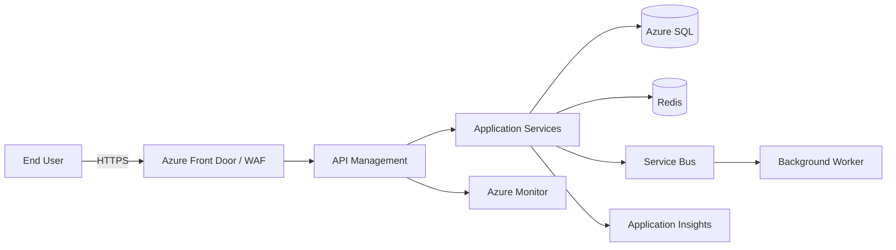
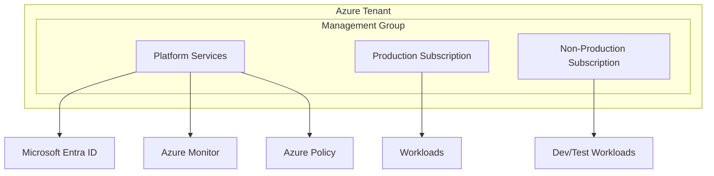
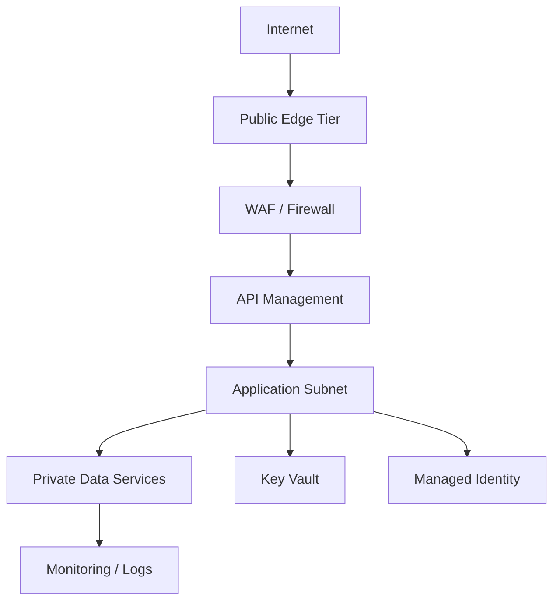
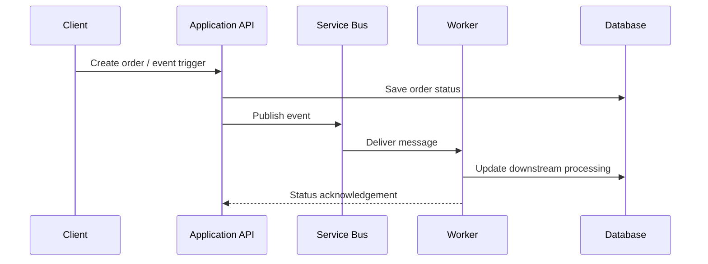

# 07. Architecture Diagrams

Diagrams are a critical communication tool for architecture reviews and stakeholder alignment.

## 1. Logical architecture flow

## 2. Landing zone reference diagram

## 3. Security and network view

## 4. Event-driven processing pattern

## Tips for architecture diagrams

- Keep the diagram readable for non-technical stakeholders
- Show major trust boundaries and security zones
- Highlight external dependencies and core integration points
- Separate ingress, application, data, and operations layers
- Use consistent naming and labels across diagrams
