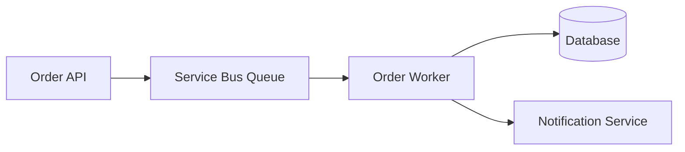
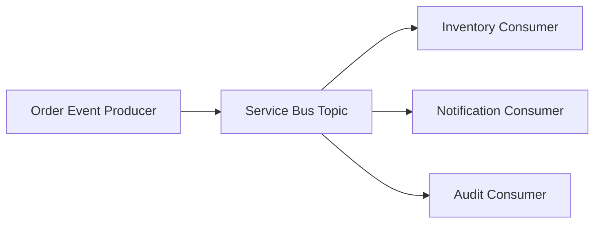
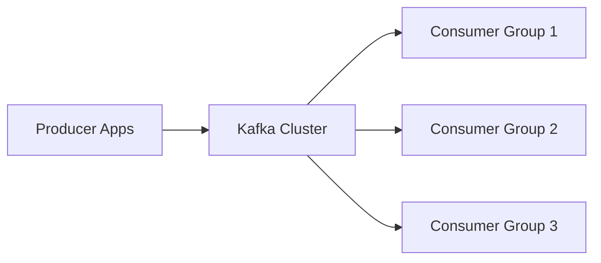
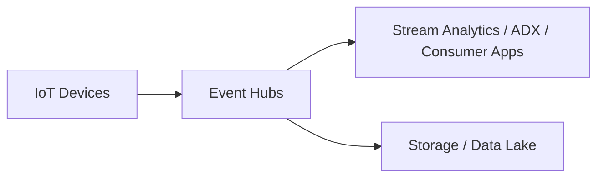
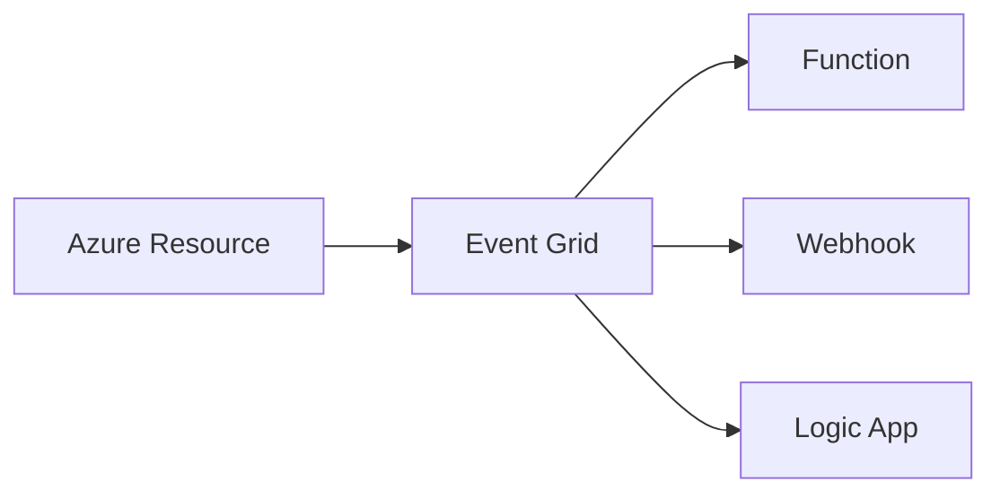

# 07. Phase 3: Messaging, Event-Driven Architecture, and Integration

## 1. Concept

Simple Hinglish:

Messaging ka purpose hota hai independent services ko asynchronously connect karna. Agar ek service slow hai ya down hai, toh doosra system fail na ho isliye messaging use hoti hai. Event-driven architecture business process ko flexible, scalable, and resilient banata hai.

Professional interview answer:

Messaging and event-driven design are used to decouple producers and consumers, support asynchronous processing, improve resiliency, manage bursts, and allow independent evolution of services. The selection between queueing and streaming technologies depends on throughput, retention, ordering, replay, delivery semantics, and consumer patterns.

## 2. Why Does a Business Need This?

Business processes often need:

- order processing without blocking user experience
- notification and downstream updates even if dependencies are slow
- reliable event delivery across services
- elasticity during seasonal spikes
- auditability and replay capability

## 3. Core Messaging Discovery Questions

- Is asynchronous communication required?
- Does the system need decoupling between producers and consumers?
- Is guaranteed delivery required?
- Are duplicate messages acceptable?
- Is ordering required?
- Are retry and dead-letter handling required?
- Is message replay needed?
- Will there be multiple consumers?
- Is throughput high and bursty?
- Is event retention required?
- Is real-time streaming required?
- Do we need durable events with analytical use cases?
- Are there on-premise integrations?

## 4. Messaging Options Overview

### Azure Service Bus

Purpose:

- reliable enterprise messaging for decoupled workloads

Best used for:

- tasks and commands
- long-running workflows
- guaranteed delivery and DLQ
- Azure-native messaging for enterprise systems

Strengths:

- queue and topic subscription model
- retry and dead-lettering
- message sessions and ordering support depending on use case

Trade-offs:

- more enterprise integration features, but not a general streaming platform

### Apache Kafka

Purpose:

- high-throughput event streaming and real-time data pipelines

Best used for:

- telemetry
- clickstream
- log/event ingestion
- stream processing

Strengths:

- partitioning and high throughput
- retention and replay
- large-scale streaming workloads

Trade-offs:

- operational complexity is higher
- more specialized skills required

### Azure Event Hubs

Purpose:

- massive telemetry ingestion and event streaming at scale

Best used for:

- IoT telemetry
- logs and event ingestion
- high-throughput event streams

Strengths:

- very high throughput
- consumer groups and stream retention
- real-time analytics patterns

Trade-offs:

- not always the best fit for traditional transactional workflow messaging

### Azure Event Grid

Purpose:

- event routing and lightweight event notification between Azure resources and apps

Best used for:

- subscription-based event notifications
- cloud resource events
- lightweight decoupling between components

Trade-offs:

- not a general-purpose queueing platform
- best for event notifications, not heavy business workflow processing

### Azure Storage Queue

Use when:

- simple queueing needs
- low-cost async operations

Trade-offs:

- limited enterprise semantics compared with Service Bus

## 5. Comparison Matrix

| Requirement | Service Bus | Kafka | Event Hubs | Event Grid | Storage Queue |
|---|---|---|---|---|---|
| Enterprise workflow messaging | Strong | Possible but not ideal | Not primary | No | Basic |
| Event streaming | Limited | Strong | Strong | Not primary | No |
| High-throughput telemetry | Limited | Strong | Strong | No | No |
| Replay | Limited by pattern | Strong | Strong | No | No |
| Guaranteed send/receive semantics | Strong | Depends on producer/consumer design | Strong | Limited | Basic |
| Multiple consumer groups | Yes | Strong | Strong | Yes | No |
| Simple notification | Possible | Not typical | Not ideal | Strong | No |
| Operational complexity | Moderate | High | Moderate | Low | Low |

## 6. Important Concepts

### Queue vs topic

- queue: single consumer or multiple worker pattern
- topic: publish to many subscribers

### Event streaming

- stream of time-ordered events
- consumers can replay or consume with offset tracking

### Delivery semantics

- at-least-once
- at-most-once
- exactly-once

Architect must explain carefully that “exactly-once” is not always absolute in distributed systems; it is often achieved with idempotent consumers and transactional patterns.

### DLQ and poison messages

Messages that fail repeatedly should be moved to DLQ for inspection rather than silently lost.

### Idempotency

Consumer logic must be designed so processing the same message twice does not create a duplicate side effect.

### Back-pressure

When consumers are slower, backlog grows. Architecture must handle it with scaling, retries, or queue size controls.

### Consumer lag

In streaming systems, lag indicates that consumer processing is behind producer pace.

## 7. Architecture Diagrams

### 7.1 Service Bus queue pattern

### 7.2 Service Bus topic pattern

### 7.3 Kafka pattern

### 7.4 Event Hubs ingestion pattern

### 7.5 Event Grid pattern

## 8. Decision Matrix

| Business scenario | Recommended technology | Why | Alternative | Limitation |
|---|---|---|---|---|
| Order processing workflow | Service Bus | reliable queue/topic model | Storage Queue | less enterprise semantics |
| Notifications and app events | Event Grid / Service Bus | lightweight event fanout | Kafka | Kafka is more complex |
| IoT telemetry | Event Hubs | very high scale + retention | Kafka | operational complexity |
| Real-time analytics | Kafka / Event Hubs | streaming and replay | Service Bus | not optimized for stream analytics |
| Audit trail and event fanout | Event Grid / Service Bus | easy event routing | Kafka | Kafka is more infrastructure-heavy |
| Long-running business workflow | Service Bus | durable workflows and DLQ | Event Grid | not workflow-oriented |

## 9. Practical Architectures

### 1. Order processing with queue

- API accepts order and stores transaction
- API publishes order event to Service Bus
- worker processes order fulfillment
- DLQ handles poison messages and retries

### 2. Topic subscription model

- order placed event published to topic
- inventory, notification, shipping, and audit all consume independently

### 3. Kafka event streaming

- event producers publish to Kafka topics
- multiple consumers consume based on partitions and groups
- replay and retention support analytics and reprocessing

### 4. Event Hubs ingestion

- devices emit telemetry
- Event Hubs handles scale and retention
- consumer groups process data for analytics or alerting

### 5. Hybrid integration

- on-prem system pushes files or events to Azure Integration layer
- Azure Service Bus or Event Hubs handles translation and downstream processing

## 10. Security and Operations

- message encryption in transit and at rest
- private networking if required
- managed identities for consumers and producers
- DLQ for failed messages
- monitoring of throughput, failures, lag, retries, backlog
- alerting on consumer lag and message queue depth

## 11. Common Mistakes

- using Kafka for every asynchronous problem
- relying on a queue but not handling retries and idempotency
- assuming all distributed system failures are infrastructure failures
- not designing message DLQ and poison-message handling
- ignoring consumer lag and backlog

## 12. Interview Questions

### Basic

- What is the difference between queue and event?
- Why would a business need asynchronous processing?
- What is a dead-letter queue?

### Intermediate

- When would you choose Service Bus over Kafka?
- What is the difference between Event Hubs and Event Grid?
- How do idempotency and retry policies impact design?

### Advanced

- How would you prevent duplicate processing in a distributed event-driven platform?
- How do you choose between synchronous and asynchronous integration?
- How do you explain exactly-once semantics realistically in an enterprise design?

## 13. Quick Revision

- Queueing is for task and workflow processing.
- Event streaming is for high-throughput, replayable event data.
- Event grid is ideal for lightweight notifications and event routing.
- Kafka and Event Hubs are best for data-intensive streaming and telemetry.

## 14. Knowledge Checkpoint

- Which technology is best for reliable order processing?
- Which technology is best for event replay and telemetry?
- What is a DLQ and why is it important?
- Why is idempotency essential in distributed processing?
- When is event-driven architecture not necessary?

---

Next step: compute, networking, and landing zone design.
