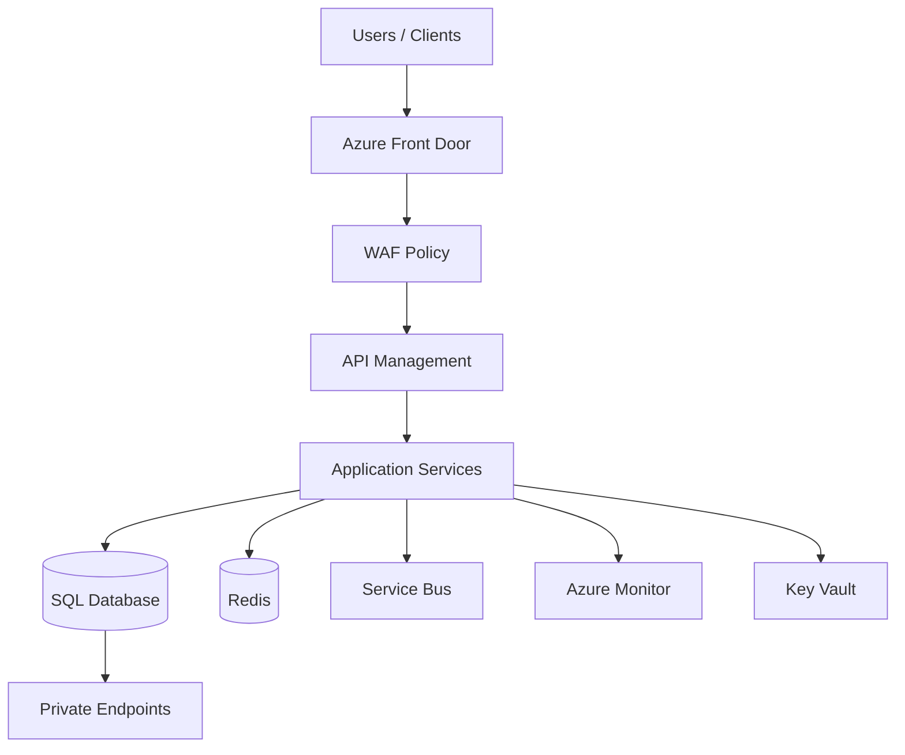

# 08. Phase 4: Compute, Networking, and Azure Landing Zone

## 1. Concept

Simple Hinglish:

Compute aur networking ka decision app ke behavior aur business requirement par depend karta hai. Aapko decide karna hota hai ki workload ko VM par deploy karna chahiye, container platform par, serverless par, ya app platform par. Network design bhi equally important hai because security, latency, and connectivity all depend on it.

Professional interview answer:

Whether a workload is hosted on VMs, containers, or serverless compute depends on operational control, application patterns, scale, team maturity, and deployment requirements. Similarly, networking architecture defines how components connect, how security is enforced, and how data is isolated, accessed, and protected.

## 2. Compute options and decision drivers

### Azure Virtual Machines

Use when:

- OS-level control required
- legacy app dependencies
- custom authentication or software stack

Pros:

- full control
- flexible

Cons:

- more patching and operational burden

### VM Scale Sets

Use when:

- horizontal scale for VM workloads
- predictable/standardized workloads

### Azure App Service

Use when:

- web app or API app without deep infrastructure management
- rapid delivery and simplified operations

Pros:

- managed platform
- easier deployment

Cons:

- less control than VMs or AKS

### Azure Kubernetes Service

Use when:

- container orchestration required
- microservices or complex deployments
- advanced scaling and automation needs

Pros:

- highly flexible and scalable
- strong ecosystem

Cons:

- higher operational complexity

### Azure Container Apps

Use when:

- containerized workloads without full AKS complexity
- APIs or event-driven microservices

### Azure Functions

Use when:

- event-driven, short-lived, serverless processing
- lightweight tasks and integrations

## 3. Compute Decision Matrix

| Business requirement | Recommended compute option | Why | Alternative | Trade-off |
|---|---|---|---|---|
| Legacy app with OS requirements | VM | full control | AKS | complexity and overhead |
| Public API portal | App Service / Container Apps | managed and fast to deploy | AKS | less flexibility |
| Microservices platform with complex orchestration | AKS | Kubernetes control | App Service | more operational effort |
| Background event processing | Functions / Container Apps | scale on demand | VM | less control |
| Containerized API with moderate complexity | Container Apps | simpler than AKS | AKS | less orchestration depth |

## 4. Networking Architecture

### Core networking elements

- VNet
- subnets
- NSG
- UDR
- Azure Firewall
- Azure Load Balancer
- Application Gateway
- Web Application Firewall (WAF)
- Front Door
- Traffic Manager
- Private Endpoint
- Private DNS
- VPN Gateway
- ExpressRoute
- NAT Gateway

## 5. Network patterns

### Hub-spoke

Use when:

- central shared services
- centralized security controls
- multiple app landing zones

### Virtual WAN

Use when:

- more global branch and hybrid connectivity pattern
- enterprise WAN simplification

## 6. Key comparisons

### NSG vs Azure Firewall

- NSG = subnet-level filtering and simple rules
- Azure Firewall = centralized, higher-level security controls, more advanced inspection

### Application Gateway vs Load Balancer

- Load Balancer = L4 layer balancing
- Application Gateway = L7 routing and WAF

### Front Door vs Application Gateway

- Front Door = global edge and routing
- Application Gateway = regional layer 7 routing and WAF for internal or regional workloads

### VPN vs ExpressRoute

- VPN = lower cost and simpler internet-based connectivity
- ExpressRoute = private, predictable, and enterprise-grade hybrid connectivity

### Private Endpoint vs Service Endpoint

- Private Endpoint = dedicated private IP into service
- Service Endpoint = service access from VNet without a dedicated private IP

## 7. Azure Landing Zone

### Why it matters

A landing zone provides the base platform that all workloads inherit.

### Core tenets

- governance and RBAC
- policy enforcement
- centralized networking
- shared identity and logging
- environment separation
- standardized deployment patterns

### Example structure

```text
Tenant
 ├── Management Groups
 │   ├── Platform Management
 │   ├── Shared Services
 │   ├── Production
 │   └── Non-Production
 ├── Production Subscription
 │   ├── Connectivity
 │   ├── Identity
 │   ├── Shared Services
 │   └── App Landing Zones
 └── Dev/Test Subscription
```

## 8. Architecture Diagram



## 9. Security and Networking Design Principles

- public entry only where necessary
- private connectivity for internal data layers
- firewall and WAF controls at edges
- managed identity and Key Vault for secrets
- use least-privilege RBAC
- do not expose databases directly to the internet

## 10. Cost and Trade-offs

- more control means more operational work
- managed platform reduces ops but may increase unit cost
- hub-spoke provides enterprise governance but adds design complexity
- regional redundancy adds cost and operational effort

## 11. Common Mistakes

- exposing databases publicly without strong reason
- using complex AKS for simple API workloads
- not factoring private connectivity requirements early
- designing network without lifecycle and support model
- ignoring ingress and egress controls

## 12. Interview Questions

### Basic

- Why is a landing zone important in Azure?
- What is the difference between a firewall and NSG?
- When would you choose AKS over App Service?

### Intermediate

- How do you decide between hub-spoke and virtual WAN?
- When should an application use private endpoints?
- Why is application gateway more than just simple load balancing?

### Advanced

- How would you design networking for a secure enterprise multi-tenant Azure environment?
- How do you justify a complex network design to a business stakeholder?
- Which layers of the architecture should be public, private, or edge-protected?

## 13. Quick Revision

- compute choice is about control, operations, scale, and complexity
- network design is about trust boundaries and required access paths
- landing zone is the platform foundation for secure growth

## 14. Knowledge Checkpoint

- Which compute option is used for simple web apps?
- Which option is best for microservices with orchestration needs?
- Why is private endpoint preferred over public access to critical data services?
- What is the core purpose of a landing zone?
- How do AZ, region, and private connectivity shape architecture decisions?

---

Next step: security and governance architecture.
