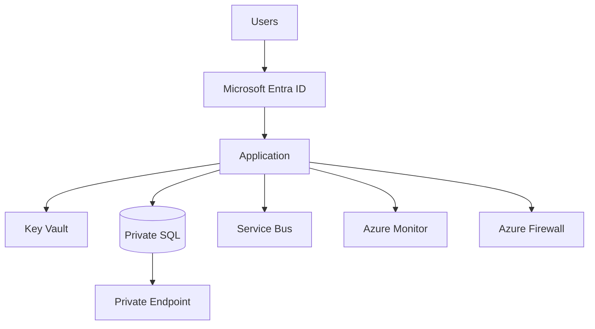

# 09. Phase 5: Security and Governance Architecture

## 1. Concept

Simple Hinglish:

Security architecture ka matlab hota hai business data, application access, identity, network, and operational controls ko ek structured way mein protect karna. Governance ka matlab hota hai policies, standards, roles, and control mechanisms ko define karna taaki agar multiple teams or clients ho, toh drift na ho aur compliance maintain rahe.

Professional interview answer:

Security and governance are foundational design principles. They shape identity, network segmentation, secrets management, auditing, policy enforcement, and compliance posture, all of which must be considered early because they significantly affect architecture, operations, and cost.

## 2. Why Does a Business Need This?

No software or platform is useful if it cannot be protected, governed, and audited. Security is not a feature; it is a design principle.

Business drivers include:

- customer trust
- regulatory compliance
- enterprise risk reduction
- operational resilience
- identity segregation and role-based access

## 3. Key Security Building Blocks

### Microsoft Entra ID

- identity and access control
- SSO and conditional access
- federation and user management

### RBAC

Role-based access control ensures access is least privilege.

### PIM

Privileged Identity Management reduces standing privileges.

### Managed Identity

- workload-based identity without secrets
- preferred for Azure service-to-service access

### Workload Identity

- use identity federation for workloads and external systems

### Key Vault

- secrets, certificates, keys
- reduces hardcoded sensitive configuration

### Private Endpoint

- private network access to Azure PaaS services
- essential for secure architecture

### Azure Firewall / WAF / NSG

- edge and internal segmentation controls
- protect from external attacks and malicious traffic

### Defender for Cloud

- security posture recommendations and monitoring

### Microsoft Sentinel / Log Analytics

- centralized security monitoring and incident investigation

## 4. Zero Trust Principles

- verify every access request
- use least privilege
- assume breach
- enforce strong identity and policy controls
- secure data and workloads independently

## 5. Governance Architecture

### Azure Policy

- enforce standards and guardrails
- policy for allowed SKUs, regions, tags, and resource configuration

### Management groups

- structure subscriptions according to business units or environments

### Tagging

- owner
- environment
- cost center
- application
- compliance

### Subscription strategy

- production, non-production, connectivity, management, and shared services separation

## 6. Example Design Pattern

## 7. Business Requirement to Security Control Mapping

| Business need | Security control |
|---|---|
| User must access app securely | Entra ID + MFA + Conditional Access |
| Application must talk to DB without secrets | Managed Identity + Key Vault |
| DB should not be public | Private Endpoint + NSG + firewall |
| Admin actions must be controlled | RBAC + PIM |
| Compliance and audit needed | Azure Policy + Defender + Log Analytics |

## 8. Security and Compliance Considerations

- encryption in transit and at rest
- separate environments for dev, test, and prod
- no direct internet access to data services unless explicitly justified
- evidence and audit logs retained according to policy
- workload isolation for multi-client or multi-tenant scenarios

## 9. Common Mistakes

- storing secrets in app configuration files
- opening database ports to the internet
- granting broad RBAC roles
- overusing shared admin accounts
- ignoring logging and retention expectations

## 10. Interview Questions

### Basic

- Why is identity a core design decision in Azure architecture?
- What is the difference between RBAC and conditional access?
- Why are private endpoints important?

### Intermediate

- How would you design zero trust for a customer-facing Azure application?
- Why is Key Vault required even in a small platform?
- How do you enforce governance across multiple subscriptions and teams?

### Advanced

- How do you design a secure architecture for a multi-tenant platform?
- How do you balance strong security with operational usability?
- What would you do if the client says “we want fast deployment but no security delay”?

## 11. Quick Revision

- Identity, network, and secrets are foundational to secure architecture.
- Azure Policy and RBAC enforce governance.
- Zero trust is not a product; it is a design philosophy.
- Security is often the reason certain patterns are selected.

## 12. Knowledge Checkpoint

- Which component is best for secrets management in Azure?
- Why is managed identity preferred over credentials in code?
- What is the difference between private endpoint and public endpoint access?
- What is the role of Azure Policy in governance?
- Why does a landing zone matter for security and compliance?

---

Next step: HA, DR, backup, and operations.
