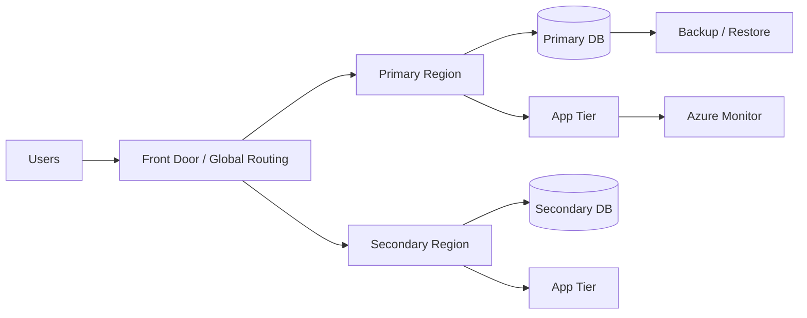

# 10. Phase 6: High Availability, Backup, Disaster Recovery, and Operations

## 1. Concept

Simple Hinglish:

High availability aur disaster recovery dono important hain, lekin dono alag concepts hain. HA ka matlab system normal operation mein available rahe. DR ka matlab agar major failure ya region issue ho toh system recover ho sake. Architect ko in dono ko clearly differentiate karna chahiye, kyunki same solution dono ke liye ideal nahi hota.

Professional interview answer:

High availability ensures services remain available during common faults and maintenance, while disaster recovery addresses broader failures such as regional outages, severe data loss, or catastrophic events. Both are influenced by RTO, RPO, workload criticality, and support model expectations.

## 2. Why Does a Business Need This?

Business wants continuity, trust, and predictable operations. A platform without structured HA/DR design is exposed to outages, broken customer experience, and unpredictable recovery.

## 3. HA vs DR

### High Availability

- handles component failure
- reduces downtime during normal operation
- often within region
- includes redundancy, load balancing, health checks

### Disaster Recovery

- handles regional or major service disruption
- includes failover, backup, restore, and recovery procedures
- usually cross-region or multi-site

## 4. Key Concepts

### RTO

Recovery Time Objective: time accepted to restore service.

### RPO

Recovery Point Objective: data loss acceptable.

### MTTR

Mean time to repair.

### MTBF

Mean time between failures.

### MTTA

Mean time to acknowledge.

## 5. Azure HA/DR Services and Patterns

- Availability Zones
- Availability Sets
- Azure Load Balancer
- Azure Front Door / Traffic Manager
- Azure SQL failover groups
- Backup vault and Recovery Services Vault
- GRS / RA-GRS storage
- Azure Site Recovery
- regional pairs and manual/automated failover

## 6. Patterns

### Active-active

- both regions handle traffic
- best for high-availability and low RTO
- complex operationally

### Active-passive

- primary region active, secondary warm or standby
- simpler but recovery time often higher

### Pilot light

- minimal environment running in secondary region
- cheaper option

### Warm standby

- secondary region active at reduced capacity

## 7. Practical Examples

### Example 1: E-commerce application

- requirement: 99.95% availability, RPO 15 min, RTO 1 hour
- solution: active-passive regional deployment, SQL failover, Redis replication, backup policy, autoscaling, monitoring

### Example 2: Payment service

- requirement: strict zero-loss or near zero data loss, very low downtime
- solution: multi-AZ, active-active or highly resilient failsafe pattern, strong security, near real-time replication

## 8. Architecture Diagram

## 9. Operations Model

### Support model

- L1: triage and first response
- L2: technical investigation
- L3: deep platform or product support

### ITIL disciplines

- change management
- incident management
- release management
- problem management
- service reviews

### 24x7 support

Needed for high business criticality and public-facing systems.

## 10. RCA and Incident Handling

- define impact, root cause, corrective action, preventive action
- document lessons learned
- monitor recurring issues

## 11. Common Mistakes

- confusing HA with DR
- designing active-active without testing real failover
- not testing restore procedures
- choosing region pairs without confirming service support
- no runbook for failover and rollback

## 12. Interview Questions

### Basic

- What is the difference between HA and DR?
- How does RTO differ from RPO?
- Why do we need backup testing?

### Intermediate

- How does a business-critical application change the DR strategy?
- When is active-passive preferable over active-active?
- How do HA and DR influence cost and operational complexity?

### Advanced

- How would you design DR for a multi-tenant enterprise platform with a 15-minute RPO?
- What architecture compromises are usually accepted for cost-sensitive workloads?
- How do you defend a DR design before leadership or a client?

## 13. Quick Revision

- HA reduces downtime within an environment.
- DR restores service after significant disruption.
- NFRs drive design decisions here.
- Testing is as important as design.

## 14. Knowledge Checkpoint

- What is the real difference between availability and disaster recovery?
- Why is RPO more critical than raw backup count?
- Which architecture is generally simpler: active-passive or active-active?
- What value do runbooks and failover drills provide?
- Why do DR plans fail if they are not tested?

---

Next step: DevOps, IaC, monitoring, and observability.
