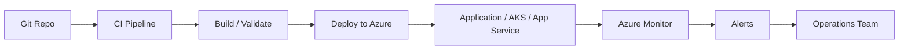

# 11. Phase 7: DevOps, Infrastructure as Code, and Monitoring

## 1. Concept

Simple Hinglish:

Architecture ka implementation sirf design se nahi hota. Uske liye automation, deployment pipeline, IaC, monitoring, and operational controls chahiye. DevOps and IaC ensure that the environment is repeatable, versioned, auditable, and easier to support.

Professional interview answer:

A well-designed Azure architecture must include repeatable delivery, environment governance, and operational visibility. This is achieved through CI/CD, infrastructure as code, secure deployment patterns, and proactive monitoring tied to business SLAs.

## 2. Why Does a Business Need This?

The business needs predictable releases, lower risk, quick rollback, and supportability. Without reliable deployment and monitoring, even a good architecture fails operationally.

## 3. Azure DevOps and GitHub

### Azure DevOps

- boards
- repos
- pipelines
- artifacts
- releases

### GitHub Actions

- convenient for modern CI/CD patterns
- often used with GitOps and automation

### Why it matters

It allows environment promotion and governance, reduces manual errors, and supports deployment traceability.

## 4. Infrastructure as Code

### Terraform

- declarative infrastructure provisioning
- strong multi-cloud and Azure adoption
- reusable modules

### Bicep

- Azure-native IaC with simpler syntax
- strong fit for Azure-native teams

### Best practices

- remote state storage
- state locking
- separate state per environment
- module reuse
- drift detection

## 5. CI/CD Patterns

- build -> validate -> deploy -> test -> promote
- manual approvals for production
- environment-specific variables and policies
- blue-green or canary deployment for critical workloads

## 6. GitOps and Deployment Strategies

### Rolling deployment

- incremental replacement of instances

### Blue-green

- new version deployed alongside old version

### Canary

- limited traffic shifted gradually

### GitOps

- desired state managed from Git

## 7. Monitoring and Observability

### Azure Monitor

- metrics, logs, alerts, dashboards

### Log Analytics

- centralized log storage and analysis

### Application Insights

- app-centric telemetry, traces, requests, failures

### OpenTelemetry

- standard instrumentation approach

### Workbooks and dashboards

- operational visibility across services

## 8. Architecture Diagram

## 9. Monitoring Design with SLA/SLO in Mind

- define SLO-driven alerts
- map metrics to business impact
- use dashboards for app and platform health
- detect failure domains early

## 10. Common Mistakes

- deploying without automated rollback plan
- no IaC state management
- no alerting on SLO breaches
- no tracing across services
- manual changes in production

## 11. Interview Questions

### Basic

- Why is IaC important in Azure architecture?
- What is the difference between CI and CD?
- Why does monitoring matter in architecture?

### Intermediate

- When would you choose Terraform over Bicep?
- How do blue-green or canary deployments help critical workloads?
- What metrics should be part of an application-level dashboard?

### Advanced

- How do you design a deployment strategy for a business-critical application with strict availability targets?
- How do you incorporate governance into CI/CD?
- How do you ensure observability for a microservices architecture?

## 12. Quick Revision

- DevOps is architecture, not just tooling.
- IaC reduces drift and enables repeatability.
- Observability is required to meet SLO and SLA commitments.
- Release strategy must be designed around business risk.

## 13. Knowledge Checkpoint

- Which service is best suited for secure deployment automation?
- Why is state management important in Terraform?
- What is the difference between blue-green and canary deployment?
- Why is metric-based alerting more useful than plain uptime checks?
- How does observability support incident management?

---

Next step: end-to-end case studies and interview preparation.
