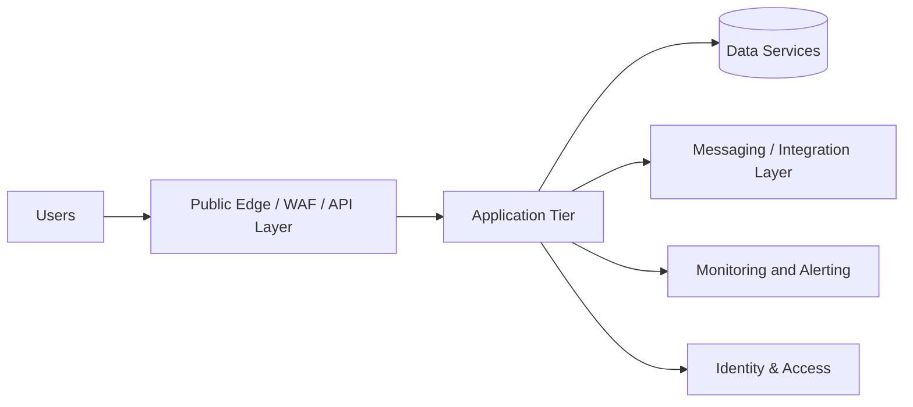

# High-Level Design (HLD) Template

## Document Control

| Item | Details |
|---|---|
| Document Name | High-Level Design |
| Project / Client |  |
| Version |  |
| Date |  |
| Prepared By |  |
| Reviewed By |  |
| Approved By |  |
| Environment | Development / Test / Production |

---

## 1. Executive Summary

### 1.1 Objective
Describe the business problem and the purpose of this solution.

### 1.2 Scope
In scope:
-  

Out of scope:
-  

### 1.3 Business Context
Explain the business drivers, users, geography, criticality, and desired outcome.

### 1.4 Key Outcomes
-  
-  
-  

---

## 2. Business and Application Overview

### 2.1 Business Requirements
-  
-  

### 2.2 Functional Requirements
-  
-  

### 2.3 Non-Functional Requirements
| Category | Requirement | Target |
|---|---|---|
| Availability |  |  |
| Performance |  |  |
| Scalability |  |  |
| Security |  |  |
| DR |  |  |
| Compliance |  |  |

### 2.4 User Personas
-  
-  

### 2.5 Operating Model
- support model
- escalation paths
- maintenance windows
- change process

---

## 3. Current-State Assessment

### 3.1 Current Architecture
Describe the current-state platform, applications, integrations, and pain points.

### 3.2 Gap Analysis
| Area | Current State | Gap | Proposed Approach |
|---|---|---|---|
| Security |  |  |  |
| Networking |  |  |  |
| App Hosting |  |  |  |
| Data Platform |  |  |  |
| Monitoring |  |  |  |

### 3.3 Target-State Summary
Describe the target architecture in business and technical terms.

---

## 4. Architecture Principles

- Security by default
- Least privilege access
- Scalability and elasticity
- Resilience and recoverability
- Cost-aware design
- Operational simplicity
- Standardization and governance

---

## 5. High-Level Solution Architecture

### 5.1 Logical Architecture Overview

### 5.2 Component Layers

| Layer | Description | Primary Responsibilities |
|---|---|---|
| Edge / Access |  |  |
| Application |  |  |
| Integration |  |  |
| Data |  |  |
| Security |  |  |
| Operations |  |  |

### 5.3 External Dependencies
-  
-  
-  

### 5.4 Assumptions and Constraints
-  
-  

---

## 6. Functional Architecture

### 6.1 Use Cases
-  
-  

### 6.2 Workflows
Describe main end-to-end workflow from user request to backend processing.

### 6.3 Integration Patterns
- synchronous API integration
- asynchronous messaging
- event-driven processing
- file transfer / batch integration

---

## 7. Technology Selection

### 7.1 Application Hosting
- Azure App Service / AKS / Container Apps / Functions / VM

### 7.2 Data Platform
- Azure SQL / PostgreSQL / MySQL / Cosmos DB / Redis / Storage

### 7.3 Messaging and Events
- Service Bus / Event Hubs / Kafka / Event Grid / Queue

### 7.4 Identity and Security
- Entra ID / RBAC / Key Vault / Firewall / Private Endpoint / WAF

### 7.5 Observability
- Azure Monitor / Log Analytics / App Insights / Sentinel / Workbooks

---

## 8. Security Architecture

### 8.1 Identity and Access
- access model
- MFA / Conditional Access
- managed identity
- RBAC model

### 8.2 Network Security
- VNet segmentation
- NSG / Firewall / WAF
- Private access design
- ingress and egress policy

### 8.3 Data Protection
- encryption at rest
- encryption in transit
- Key Vault usage
- secret rotation approach

### 8.4 Compliance Controls
- audit requirements
- retention and traceability
- policy enforcement

---

## 9. Availability, Resilience, and Disaster Recovery

### 9.1 Availability Requirements
| Service | Availability Target | Rationale |
|---|---|---|
| Web Tier |  |  |
| API Tier |  |  |
| Data Tier |  |  |

### 9.2 Resilience Model
- health checks
- retries and timeouts
- circuit breakers
- queue-based decoupling
- auto-scaling strategy

### 9.3 DR Model
- active-passive / active-active / warm standby
- RTO
- RPO
- failover procedure
- restore strategy

---

## 10. Networking Architecture

### 10.1 Connectivity Overview
- public ingress
- private backend connectivity
- hybrid connectivity

### 10.2 Network Zones
- edge
- application
- data
- management

### 10.3 Routing and Security Controls
- DNS
- load balancer
- firewall
- private endpoints
- API access path

---

## 11. DevOps and Release Strategy

### 11.1 CI/CD Approach
- source control
- build validation
- deployment environments
- promotions

### 11.2 Deployment Pattern
- rolling / blue-green / canary

### 11.3 IaC Model
- Terraform / Bicep
- state management
- environment parity

---

## 12. Monitoring and Operations

### 12.1 Monitoring Strategy
- app performance
- infra health
- logs and metrics
- alerting thresholds

### 12.2 Support Model
- L1 / L2 / L3
- on-call requirements
- runbooks
- incident process

### 12.3 KPIs and Dashboards
- latency
- success rate
- system health
- transaction throughput

---

## 13. Cost and Operational Considerations

### 13.1 Cost Drivers
- compute
- database
- networking
- monitoring
- external integrations

### 13.2 Optimization Approach
- autoscaling
- right-sizing
- reserved capacity
- caching
- platform managed services

---

## 14. Risks, Assumptions, and Open Issues

| Item | Type | Description | Mitigation |
|---|---|---|---|
|  | Risk / Assumption / Issue |  |  |

---

## 15. Architecture Decision Summary

| Decision | Selected Option | Reason | Alternative Considered |
|---|---|---|---|
| Compute |  |  |  |
| Data platform |  |  |  |
| Messaging |  |  |  |
| Network model |  |  |  |
| Security model |  |  |  |

---

## 16. Decision and Sign-off

### 16.1 Approvals
- Business owner:
- Technical owner:
- Security owner:
- Operations owner:

### 16.2 Open Decisions
-  
-  

---

## 17. Appendix

- glossary
- acronyms
- references
- relevant diagrams

This template is intended to be used as a professional client-facing HLD document and can be further customized for internal review, architecture review board, or executive presentation.
